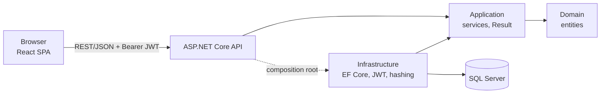

# Grocery List

A demo web application for keeping a private grocery list. Users register and log in, then add and
remove products and tag them as picked up ("in the basket") or put them back. Nobody can see or
change another user's list.

- **Backend:** ASP.NET Core REST API on .NET 10, pragmatic Clean Architecture, EF Core, SQL Server.
- **Frontend:** React 19 + TypeScript single-page app (Vite, Sass), mobile-first and accessible.
- **Contract:** REST/JSON documented with OpenAPI 3.1, the only coupling between the two.

## Contents

- [User stories](#user-stories)
- [Quick start (Docker)](#quick-start-docker)
- [Two-minute walkthrough](#two-minute-walkthrough)
- [Development without Docker](#development-without-docker)
- [Running the tests](#running-the-tests)
- [Repository structure](#repository-structure)
- [Architecture summary](#architecture-summary)
- [How to add a new feature](#how-to-add-a-new-feature)
- [Design notes](#design-notes)
- [Known issues and next steps](#known-issues-and-next-steps)
- [AI-assisted development](#ai-assisted-development)

## User stories

| # | As a user I can… | Where |
|---|---|---|
| 1 | register with a username, full name and password | `/register`, `POST /api/auth/register` |
| 2 | log in with my username and password | `/login`, `POST /api/auth/login` |
| 3 | see my own grocery list, and never another user's items | `/`, `GET /api/grocery-items` |
| 4 | add a product | Add form, `POST /api/grocery-items` |
| 5 | remove a product | Trash button, `DELETE /api/grocery-items/{id}` |
| 6 | tag a product as in the basket | Round toggle, `PUT /api/grocery-items/{id}/basket` |
| 7 | un-tag a product (put it back) | Same toggle, `DELETE /api/grocery-items/{id}/basket` |
| 8 | log out | "Log out" in the top bar (client-side, see [ADR 0003](docs/adr/0003-jwt-bearer-and-client-side-logout.md)) |
| 9 | see no products without a session; logging in is mandatory | Redirect to `/login`; the API returns 401 |

How each story is implemented and tested: [docs/architecture.md](docs/architecture.md#1-functional-overview).

## Quick start (Docker)

**Prerequisites:** [Docker Desktop](https://www.docker.com/products/docker-desktop/) (or Docker
Engine with Compose v2), running, with about 2 GB of free memory for SQL Server. Nothing else is
needed: the .NET SDK and Node.js are only used inside the images.

1. Create your `.env` from the example. Its values work as they are for a local demo.

   PowerShell:

   ```powershell
   Copy-Item .env.example .env
   ```

   bash / zsh:

   ```bash
   cp .env.example .env
   ```

2. Build and start SQL Server, the API and the web app. The first run takes a few minutes (image
   downloads and builds). The API applies the database migrations on start-up.

   ```bash
   docker compose up -d --build
   ```

3. Open the app:

   | What | URL |
   |---|---|
   | Web app | <http://localhost:3000> |
   | API | <http://localhost:8080> |
   | API docs (Scalar, try the API) | <http://localhost:8080/scalar> |
   | Health check | <http://localhost:8080/health> (`Healthy`) |

   If the web app cannot reach the API right after start-up, wait a few seconds: the API waits for
   SQL Server to become healthy first. `docker compose ps` shows the state of each container.

Stop everything with `docker compose down`. Add `-v` to also delete the database volume and start
from scratch next time.

Ports 3000 and 8080 can be changed in `.env` (`WEB_PORT`, `API_PORT`); SQL Server uses 1433. If
you change `MSSQL_SA_PASSWORD`, do not use `;` (it is embedded in a connection string).

## Two-minute walkthrough

Open <http://localhost:3000>:

1. **Login is mandatory (9).** You are redirected to the login page.
2. **Register (1).** Choose *Create an account*, enter a username, full name and a password of at
   least 8 characters. You are signed in and land on your empty list.
3. **Add (4).** Add `Milk` with quantity 2 (use the − / + stepper), then `Bread` and `Eggs`. Try
   adding `milk` again: the form explains it is already in your list.
4. **Tag (6).** Tap the circle next to *Milk*. It leaves *To buy*, the progress bar moves, and
   *In basket (1)* counts it. Switch to *In basket* or *All* (struck through) to see it.
5. **Un-tag (7).** In *In basket*, tap the circle again to put it back.
6. **Remove (5).** Remove *Bread* with the trash button.
7. **Log out (8) and log in (2).** Log out from the top bar, then log in again: your list is still there.
8. **Privacy (3).** In a private window, register a second user: their list is empty and they
   cannot see yours.
9. **Without a session (9), from the API side.** <http://localhost:8080/api/grocery-items> returns
   `401` with a ProblemDetails body. In <http://localhost:8080/scalar> you can register, paste the
   token under *Authentication* and try every endpoint. Asking for another user's item id returns
   `404`, exactly like an id that does not exist.

## Development without Docker

Run SQL Server in Docker, and the API and the frontend locally with hot reload.

**Prerequisites:** Docker Desktop, the [.NET 10 SDK](https://dotnet.microsoft.com/download) and
[Node.js 24](https://nodejs.org/).

```bash
# 1. Database only (uses MSSQL_SA_PASSWORD from .env; copy .env.example first if needed)
docker compose up -d sqlserver

# 2. API on http://localhost:5079 (Scalar at /scalar). Development settings apply migrations on start-up.
cd backend
dotnet tool restore            # dotnet-ef, pinned in backend/.config/dotnet-tools.json
dotnet watch --project src/GroceryList.Api

# 3. In a second terminal: frontend on http://localhost:5173
cd frontend
npm ci
npm run dev
```

Vite proxies `/api` to `http://localhost:5079`, so the frontend needs no `.env` and there is no CORS
in development. The development connection string and JWT key in
`backend/src/GroceryList.Api/appsettings.Development.json` match `.env.example`. If you changed
`MSSQL_SA_PASSWORD` in `.env`, override the connection string with user-secrets:

```bash
dotnet user-secrets set "ConnectionStrings:GroceryListDb" "Server=localhost,1433;Database=GroceryList;User Id=sa;Password=<your password>;TrustServerCertificate=True" --project src/GroceryList.Api
```

Useful API commands (from `backend/`):

```bash
dotnet ef migrations add <Name> --project src/GroceryList.Infrastructure --startup-project src/GroceryList.Api --output-dir Persistence/Migrations
dotnet ef database update --project src/GroceryList.Infrastructure --startup-project src/GroceryList.Api
```

## Running the tests

| Suite | Command | Notes |
|---|---|---|
| Backend, all | `cd backend` then `dotnet test` | |
| Backend unit (127) | `dotnet test tests/GroceryList.UnitTests` | Domain, services with fakes, JWT, hashing. No Docker needed. |
| Backend integration (54) | `dotnet test tests/GroceryList.IntegrationTests` | Real HTTP pipeline against SQL Server 2022 started by Testcontainers. **Docker must be running.** |
| Frontend (41) | `cd frontend` then `npm test` | Vitest + Testing Library (jsdom). Also `npm run lint` and `npm run build`. |

CI ([`.github/workflows/ci.yml`](.github/workflows/ci.yml)) runs all of the above on every push and
pull request. It builds the backend with `-warnaserror`, and fails if
`dotnet list package --vulnerable --include-transitive` reports any vulnerable package.

## Repository structure

```text
grocery-list-app/
├── backend/                     .NET solution (GroceryList.slnx)
│   ├── src/
│   │   ├── GroceryList.Domain/          entities and invariants, no dependencies
│   │   ├── GroceryList.Application/     use-case services, Result pattern, DTOs, ports
│   │   ├── GroceryList.Infrastructure/  EF Core + SQL Server, repositories, JWT, password hashing
│   │   └── GroceryList.Api/             controllers, auth, ProblemDetails, OpenAPI (composition root)
│   ├── tests/
│   │   ├── GroceryList.UnitTests/
│   │   └── GroceryList.IntegrationTests/
│   └── Dockerfile
├── frontend/                    React + TypeScript SPA (Vite, Sass)
│   ├── src/
│   │   ├── api/                 HTTP client (token, ProblemDetails → ApiError)
│   │   ├── components/          shared UI components
│   │   ├── features/auth/       session, login, register
│   │   ├── features/groceries/  list view model, views, rows, add form
│   │   ├── routes/              routing, protected and anonymous routes, layout
│   │   └── styles/              design tokens, mixins, global styles
│   ├── Dockerfile, nginx.conf
├── docs/                        architecture, API reference, ADRs, known issues
├── .github/workflows/ci.yml     CI
├── docker-compose.yml           SQL Server + API + web
└── .env.example                 configuration template (copy to .env)
```

## Architecture summary



- **Clean Architecture, kept pragmatic:** dependencies point inward, and only the Api references
  Infrastructure. There is no MediatR, CQRS, AutoMapper or generic repository.
- **Expected errors are values.** Services return `Result`/`Result<T>`, and the API turns them into
  RFC 9457 ProblemDetails with a stable `code`. A global `IExceptionHandler` handles the unexpected.
- **Ownership comes from the token.** The user id is never read from the request, every query
  filters by owner, and another user's item returns 404, not 403.
- **Security:** PBKDF2 password hashing, HS256 JWT with full validation, an authenticated-by-default
  fallback policy, and the same response and timing for an unknown username and a wrong password.
- **Frontend:** feature folders and a view-model hook (`useGroceryList`) as the single source of
  truth, with derived views in the URL. Tag and un-tag update optimistically and roll back on
  failure, keyboard focus is managed explicitly, and there is no global state library.

| Document | Contents |
|---|---|
| [docs/architecture.md](docs/architecture.md) | Stories → endpoints, C4 context/container/component diagrams, sequence diagrams, data model, error handling, security, testing, proposed Azure deployment |
| [docs/api.md](docs/api.md) | Endpoints with real request/response examples and the error code catalogue |
| [docs/adr/](docs/adr/) | Architecture decision records 0001–0008 |
| [docs/known-issues.md](docs/known-issues.md) | Limitations and future work |

## How to add a new feature

This walks through **partial quantities in the basket** as an example: with "Eggs × 12", the user
can record that 6 are already in the basket. **It is intentionally not implemented.** It is listed
as a next step in [known-issues.md](docs/known-issues.md). Follow the layers from the inside out,
with tests at each one.

### 1. Domain (`backend/src/GroceryList.Domain/Entities/GroceryItem.cs`)

Replace the stored flag with a count and derive the flag from it:

```csharp
public int QuantityInBasket { get; private set; }

/// <summary>True when every unit has been picked up.</summary>
public bool IsInBasket => QuantityInBasket == Quantity;

/// <summary>Puts <paramref name="quantity"/> units in the basket (all of them when null).</summary>
public void PutInBasket(int? quantity = null)
{
    var target = quantity ?? Quantity;
    ArgumentOutOfRangeException.ThrowIfNegative(target);
    ArgumentOutOfRangeException.ThrowIfGreaterThan(target, Quantity);
    QuantityInBasket = target;
}

public void RemoveFromBasket() => QuantityInBasket = 0;
```

The invariant is `0 ≤ QuantityInBasket ≤ Quantity`. *Tests:* `GroceryItemTests` for the default
(all units), a partial quantity, both bounds, out-of-range values throwing, and `IsInBasket`
following the count. (The repository's `CLAUDE.md` asks for agreement before Domain changes.)

### 2. Application (`GroceryList.Application/GroceryItems`)

- Add `public sealed record PutInBasketRequest(int? Quantity);`.
- Change `GroceryItemService.PutInBasketAsync(Guid id, PutInBasketRequest? request, CancellationToken ct)`.
  It validates the request **before** calling the Domain, so the Domain exception never fires:
  `Quantity` must be between 0 and the item's quantity, or the method returns a new
  `Errors.GroceryItems.QuantityInBasketInvalid` (Validation → 400). Ownership still comes from
  `GetByIdForUserAsync(id, currentUser.UserId)`.
- Add `QuantityInBasket` to `GroceryItemResponse` and its mapping. Keep `IsInBasket`, so existing
  clients keep working: the change only adds to the contract.

*Tests:* `GroceryItemServiceTests` for a partial quantity, no body (= all), each invalid value
(400, nothing saved), and another user's item (404).

### 3. Infrastructure: mapping and migration

In `GroceryItemConfiguration`, map `QuantityInBasket` as required and `builder.Ignore(i => i.IsInBasket)`,
because it is now computed. Then, from `backend/`:

```bash
dotnet ef migrations add PartialBasketQuantities --project src/GroceryList.Infrastructure --startup-project src/GroceryList.Api --output-dir Persistence/Migrations
```

Edit the generated migration so existing data survives. Add the column, copy the old flag
(`UPDATE GroceryItems SET QuantityInBasket = Quantity WHERE IsInBasket = 1`), then drop
`IsInBasket`. A check constraint (`QuantityInBasket BETWEEN 0 AND Quantity`) keeps the invariant in
the database too. *Tests:* a `PersistenceTests` case that saves and reloads a partial quantity.

### 4. API (`GroceryItemsController`)

`PUT /api/grocery-items/{id}/basket` accepts an **optional** body `{ "quantity": 6 }`. An empty
body keeps today's meaning (all units), so the current frontend keeps working:

```csharp
[HttpPut("{id:guid}/basket")]
public async Task<IActionResult> PutInBasket(
    Guid id,
    [FromBody(EmptyBodyBehavior = EmptyBodyBehavior.Allow)] PutInBasketRequest? request,
    CancellationToken cancellationToken)
```

The request is still idempotent, because it sets an absolute value rather than adding to it
([ADR 0007](docs/adr/0007-basket-as-sub-resource.md)). *Tests:* integration tests for a body, no
body, an out-of-range value (`400 GroceryItems.QuantityInBasketInvalid`), and another user's item
(`404`). Update [docs/api.md](docs/api.md) with a real example.

### 5. Frontend (`frontend/src/features/groceries`)

- **`types.ts`:** add `quantityInBasket: number`.
- **`groceriesApi.putInBasket(id, quantity?)`:** send the body only when a quantity is given.
- **`useGroceryList`:** add `setQuantityInBasket(item, quantity)`. It updates optimistically like
  `toggleBasket`, remembers the previous count, restores it on failure, and uses the same per-item
  pending guard.
- **`GroceryItemRow`:** when `quantity > 1`, show a compact − / + stepper ("6 of 12"). Build it from
  the same `TextField` adornment pattern as `AddItemForm`, with 44px buttons and labels like
  "Increase quantity in basket for Eggs". The round toggle still means all or none.
- **`groceryViews.ts`:** decide whether partially picked items count as "To buy". Probably yes,
  until the count reaches the quantity.

*Tests:* in `useGroceryList.test.ts`, the optimistic update and rollback of a partial quantity. In
`GroceryListPage.test.tsx`, the stepper's accessible names and keyboard use, and where a partially
picked item appears.

### 6. Finish

Run `dotnet build`, `dotnet test`, `npm run lint`, `npm test` and `npm run build`. Update the docs
(API reference, the data model in `architecture.md`) and add an ADR if a decision was made, for
example how partial items count in the views. Commit in small Conventional Commits, one per layer.

## Design notes

- **Colours:** the palette (navy `#1B1F5E`, orange accent `#F07B1F`, light background `#F5F6FA`) is
  inspired by the 2Share brand colours. **No company logo, trademark or other 2Share asset** is used;
  the basket mark is a generic inline SVG icon.
- **Contrast:** the brand orange is used only as decoration (progress bar, logo square) or behind
  dark icons, because white text on it fails WCAG AA. A darker orange (`#C2560C`) carries white
  text.
- **Accessibility:**
  - every control has a label, a visible focus ring and a touch target of at least 44px;
  - the view filter follows the WAI-ARIA tabs pattern;
  - basket moves are announced to screen readers, and focus is managed after each toggle.
- **Mobile first:** the auth pages switch to the split layout from 1024px.
- **Hero image:** `frontend/src/assets/auth-hero.webp`, photo by **[author to be confirmed]**.
  The image shows third-party product packaging and is used for this non-commercial demo only.

## Known issues and next steps

See [docs/known-issues.md](docs/known-issues.md). Highlights:

- **Sessions:** no refresh tokens or token revocation; a token is valid until it expires (60 minutes).
- **Login:** no rate limiting or lockout.
- **Validation:** one validation error per response.
- **Migrations:** applied on start-up in the Docker demo and in Development, not in production.
- **Next feature:** partial quantities in the basket (see [How to add a new feature](#how-to-add-a-new-feature)).
- **Azure:** a deployment is proposed in the architecture document but not provisioned.

## AI-assisted development

This project was built with [Claude Code](https://claude.com/claude-code) as a pair programmer.
I set the requirements, architecture rules and conventions (see [`CLAUDE.md`](CLAUDE.md)), and
every change was reviewed and tested by me.
