# Architecture

This document describes the Grocery List application **as implemented**. Anything not built is
marked **(planned)** or **(proposal)**. Decisions are recorded as ADRs in [`adr/`](adr/), the HTTP
contract in [`api.md`](api.md), and limitations in [`known-issues.md`](known-issues.md).

## Contents

1. [Functional overview](#1-functional-overview)
2. [System architecture (C4 levels 1–2)](#2-system-architecture)
3. [Software architecture (C4 level 3)](#3-software-architecture)
4. [Key flows (sequence diagrams)](#4-key-flows)
5. [Data model](#5-data-model)
6. [Error handling](#6-error-handling)
7. [Security](#7-security)
8. [Testing](#8-testing)
9. [Deployment: local and proposed Azure](#9-deployment)

---

## 1. Functional overview

A user registers, logs in, and manages a private grocery list: add and remove products, and tag a
product as picked up ("in the basket") or put it back. Nobody can see or change another user's list.

| # | User story | API endpoint | Frontend | Verified by |
|---|---|---|---|---|
| 1 | Register with username, full name and password | `POST /api/auth/register` → 201 + token | `/register` (`RegisterPage`) | `AuthTests`, `AuthServiceTests` |
| 2 | Log in with username and password | `POST /api/auth/login` → 200 + token | `/login` (`LoginPage`) | `AuthTests`, `AuthServiceTests`, `LoginPage.test.tsx` |
| 3 | See only my own list | `GET /api/grocery-items` and `GET /api/grocery-items/{id}` (filtered by the token's user) | `/` (`GroceryListPage`) | `OwnershipTests`, `GroceryItemServiceTests` |
| 4 | Add a product | `POST /api/grocery-items` → 201 | `AddItemForm` (name + quantity stepper) | `GroceryItemsTests`, `useGroceryList.test.ts` |
| 5 | Remove a product | `DELETE /api/grocery-items/{id}` → 204 | Remove (trash) button on each row | `GroceryItemsTests`, `useGroceryList.test.ts` |
| 6 | Tag a product (put in basket) | `PUT /api/grocery-items/{id}/basket` → 204 | Round toggle on each row (optimistic) | `GroceryItemsTests`, `useGroceryList.test.ts`, `GroceryListPage.test.tsx` |
| 7 | Un-tag a product (put back) | `DELETE /api/grocery-items/{id}/basket` → 204 | Same toggle (optimistic) | as above |
| 8 | Log out | *No endpoint*: the client discards its token ([ADR 0003](adr/0003-jwt-bearer-and-client-side-logout.md)) | "Log out" button in the top bar (`AppLayout`) | `AuthProvider` behaviour |
| 9 | No session, no products; login is mandatory | Fallback authorization policy: every endpoint without `[AllowAnonymous]` returns 401 | `ProtectedRoute` redirects to `/login`; a 401 on an authenticated call clears the session | `AuthorizationTests`, `ProtectedRoute.test.tsx` |

Additional endpoints that support the stories: `GET /api/users/me` (restores the session after a
reload and shows the user's name), `GET /health` (database reachability) and, when enabled,
`/openapi/v1.json` plus the Scalar UI at `/scalar`.

Frontend extras beyond the stories: "To buy / In basket / All" views stored in `?view=`, a progress
summary ("2 of 5 in basket"), and explicit focus management with screen reader announcements
([ADR 0006](adr/0006-react-typescript-sass-without-global-state.md)).

---

## 2. System architecture

### C4 level 1: system context

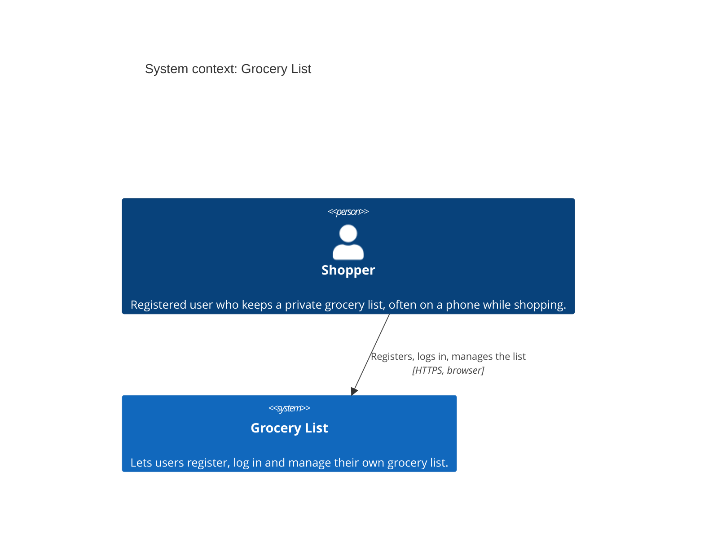

There are no external systems: no identity provider, e-mail service or third-party API.

### C4 level 2: containers

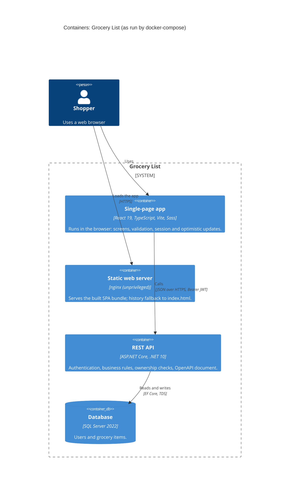

| Container | Local (docker-compose) | Notes |
|---|---|---|
| Static web server | `web` service, `http://localhost:3000` | The API URL is baked into the bundle at build time (`VITE_API_BASE_URL`). |
| REST API | `api` service, `http://localhost:8080` | Runs as a non-root user. CORS allows only the SPA origins. Migrations run on start-up in this demo setup. |
| Database | `sqlserver` service, port 1433 | Named volume `sqlserver-data`. |

In development, `npm run dev` serves the SPA on `http://localhost:5173` and proxies `/api` to the
API on `http://localhost:5079`, so no CORS or `.env` is needed.

### The only coupling is the HTTP contract

The SPA and the API share **no code and no build**. They are coupled only through the REST/JSON
contract documented in [`api.md`](api.md) and published by the API as an OpenAPI 3.1 document
(`/openapi/v1.json`, browsable at `/scalar`):

- The frontend's TypeScript types (`features/*/types.ts`) mirror the API's request and response
  records, and its validation rules mirror the Domain constants (e.g. `NAME_MAX_LENGTH = 100`).
- Errors use one shape everywhere, RFC 9457 ProblemDetails with a stable `code`, and the frontend
  branches on `code`, never on message text.
- Either side can be rebuilt, redeployed or replaced independently as long as the contract holds.
  Keeping both in one repository is about convenience, not coupling
  ([ADR 0002](adr/0002-monorepo-backend-and-frontend.md)).

---

## 3. Software architecture

### Backend: C4 level 3 (components of the REST API)

The backend follows a pragmatic Clean Architecture in four projects
([ADR 0001](adr/0001-pragmatic-clean-architecture.md)).

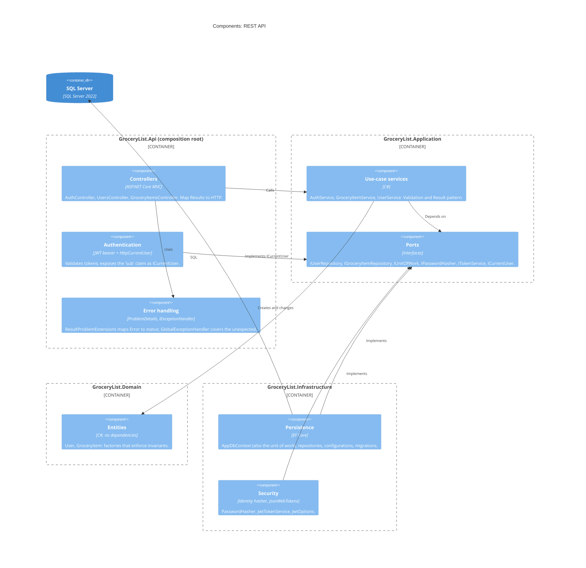

#### Dependency direction

Project references point inward only. The Api is the only project that references
Infrastructure, and only to wire it up (`AddInfrastructure`).

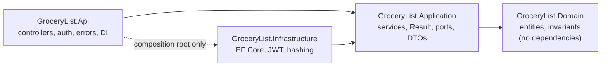

| Layer | Contains | Must not |
|---|---|---|
| Domain | `User`, `GroceryItem` with `Create(...)` factories and constants (lengths, min quantity). Ids are v7 GUIDs stamped with the creation time. | Reference any other project or package. |
| Application | Services returning `Result`/`Result<T>`, the `Errors` catalogue, request/response records, ports. | Know about HTTP, EF Core or JWT libraries. |
| Infrastructure | `AppDbContext` (EF Core, SQL Server, retry on failure), repositories, `PasswordHasher`, `JwtTokenService`, validated `JwtOptions`. | Contain business rules. |
| Api | Controllers, JWT bearer validation, `HttpCurrentUser`, ProblemDetails, CORS, OpenAPI, health check, migrations-on-start-up switch. | Contain business rules or touch EF Core directly (except the health check and migrations). |

Conventions applied throughout: time comes from `TimeProvider`, the user id always comes from
`ICurrentUser` (the token), every async method takes a `CancellationToken`, and there is no
MediatR, AutoMapper, CQRS or generic repository.

### Frontend structure

The SPA is organised by feature. Components render; hooks own state and side effects.

```text
frontend/src/
├── api/httpClient.ts           fetch wrapper: base URL, Bearer token, ProblemDetails → ApiError, 401 hook
├── components/                 presentational building blocks (Button, TextField, ErrorBanner,
│                               EmptyState, SkeletonList, Spinner, icons)
├── features/
│   ├── auth/                   authApi, session (localStorage), AuthProvider + useAuth,
│   │                           AuthLayout, LoginPage, RegisterPage, validation
│   └── groceries/              groceriesApi, useGroceryList (view model), groceryViews (filters),
│                               useFocusAfterToggle, GroceryListPage, AddItemForm,
│                               GroceryItemRow, ViewTabs, ProgressSummary, validation
├── routes/                     routes, ProtectedRoute, AnonymousRoute, AppLayout
└── styles/                     design tokens (_variables), mixins, global styles
```

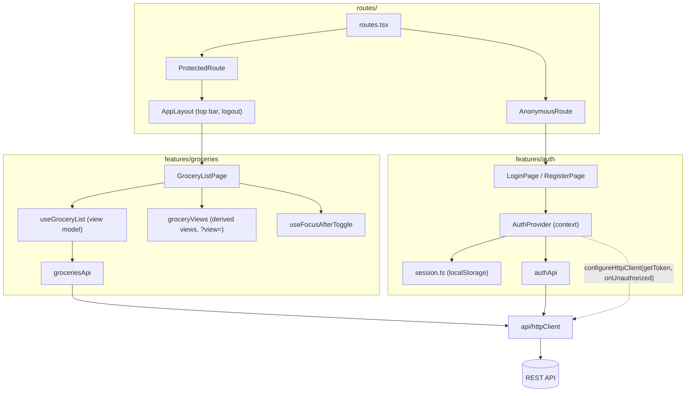

- **`httpClient` depends on nothing in the features.** The auth feature plugs in the token and the
  401 handler through `configureHttpClient`, so the client stays generic and testable.
- **No global state library.** Auth is a React context; the list state lives in the
  `useGroceryList` hook, the single source of truth for the page
  ([ADR 0006](adr/0006-react-typescript-sass-without-global-state.md)).

---

## 4. Key flows

### Register and log in

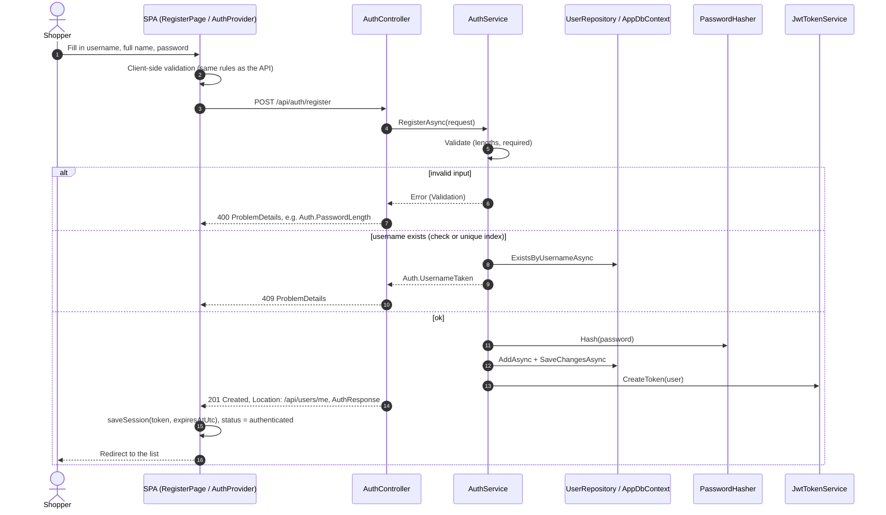

Login follows the same path through `POST /api/auth/login`. The one difference is that both failure
cases return the same `401 Auth.InvalidCredentials`, and an unknown username still pays for a hash
verification (see [Security](#7-security)):

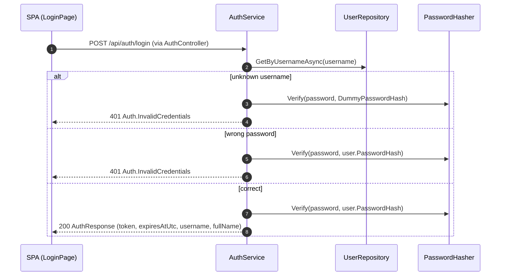

After a page reload, `AuthProvider` finds the stored token, shows "Restoring your session…", and
calls `GET /api/users/me`. If that fails for any reason (expired token, deleted user, API down) the
session is cleared and the user starts signed out.

### Add an item

Adding is **not** optimistic: the server assigns the id and may reject a duplicate name.

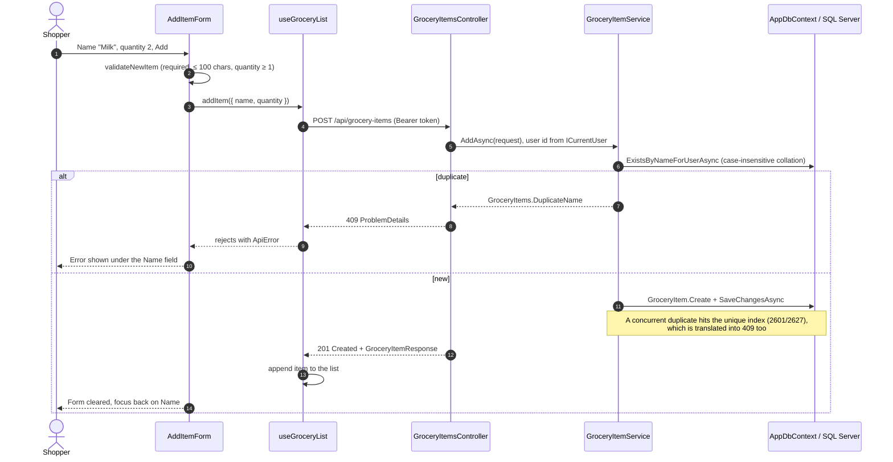

### Tag / un-tag with optimistic update and rollback

```mermaid
sequenceDiagram
  autonumber
  actor U as Shopper
  participant P as GroceryListPage
  participant VM as useGroceryList
  participant C as GroceryItemsController

  U->>P: Click the toggle on "Milk"
  P->>P: isPending(id)? then ignore
  P->>P: useFocusAfterToggle.prepare (next / previous row or empty state)
  P->>P: Live region: "Milk moved to basket"
  P->>VM: toggleBasket(item)
  VM->>VM: begin(id), the double-click guard
  VM->>VM: Optimistic: isInBasket = true (row moves view at once)
  VM->>C: PUT /api/grocery-items/{id}/basket
  alt 204 No Content
    C-->>VM: success
    VM->>VM: end(id)
  else error (network, 404, 500…)
    C-->>VM: ApiError
    VM->>VM: Roll back: isInBasket = false
    VM->>VM: actionError = "Could not put “Milk” in the basket. …"
    VM->>VM: end(id)
    VM-->>U: ErrorBanner (role="alert"); item is back in its view
  end
```

Un-tagging is the same flow with `DELETE /api/grocery-items/{id}/basket`. Both endpoints are
idempotent, so repeating a request is harmless
([ADR 0007](adr/0007-basket-as-sub-resource.md)).

### Request for another user's item → 404

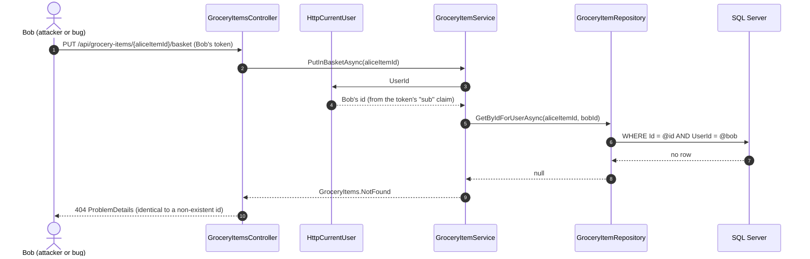

The user id is never read from the URL or body, so there is nothing to tamper with. Ownership is
part of every query, not a separate check that could be forgotten.

---

## 5. Data model

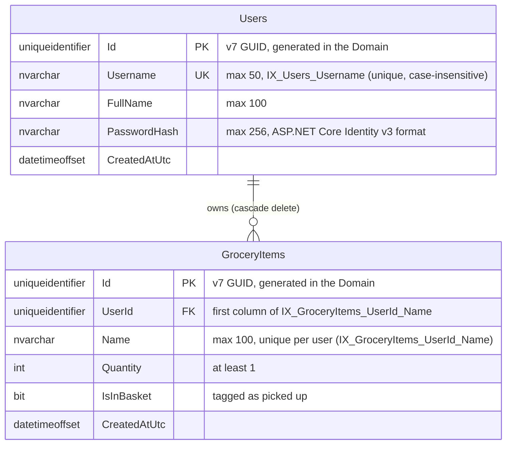

| Table | Key | Indexes and constraints |
|---|---|---|
| `Users` | `Id` (PK, clustered) | `IX_Users_Username`: unique |
| `GroceryItems` | `Id` (PK, clustered) | `IX_GroceryItems_UserId_Name`: unique on (`UserId`, `Name`); FK `UserId` → `Users.Id`, `ON DELETE CASCADE` |

- **Case-insensitive uniqueness** comes from SQL Server's default collation
  (`SQL_Latin1_General_CP1_CI_AS`): "Milk" and "milk" collide, matching the Application's check.
- **No separate `UserId` index:** `UserId` leads the unique index, which already serves the
  per-user queries and the foreign key.
- **Uniqueness is checked twice on purpose:** the Application checks first for a friendly error,
  and the unique index catches races. `AppDbContext` translates SQL errors 2601/2627 into
  `UniqueConstraintViolationException`, and the services map that to the same 409.
- **Schema changes** are EF Core migrations in `Infrastructure/Persistence/Migrations`
  (`InitialCreate`) ([ADR 0004](adr/0004-sql-server-and-ef-core.md)).

---

## 6. Error handling

Expected outcomes and unexpected failures take two different, explicit paths
([ADR 0005](adr/0005-result-pattern-over-exceptions.md)).

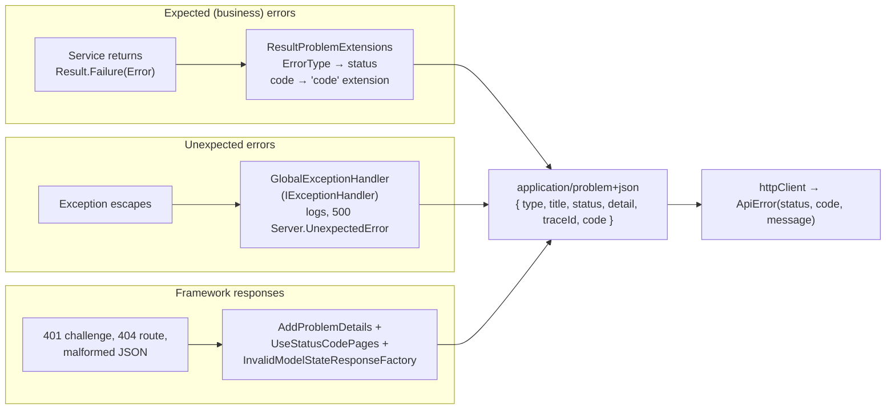

| Source | Mechanism | Example `code` | Status |
|---|---|---|---|
| Validation rule in a service | `Errors.*` returned as `Result` | `GroceryItems.NameRequired`, `Auth.PasswordLength` | 400 |
| Unreadable request body | `InvalidModelStateResponseFactory` | `Request.Invalid` | 400 |
| Bad credentials, deleted user | `Errors.Auth.InvalidCredentials`, `Errors.Users.CurrentUserNotFound` | | 401 |
| Missing or invalid token | JWT bearer challenge + `CustomizeProblemDetails` | `Auth.Unauthenticated` | 401 |
| Unknown or foreign item | `Errors.GroceryItems.NotFound` | `GroceryItems.NotFound` | 404 |
| Unknown route (authenticated) | Status code pages | `Http.NotFound` | 404 |
| Duplicate username or item name | `Errors.*`, plus the unique index as a safety net | `Auth.UsernameTaken`, `GroceryItems.DuplicateName` | 409 |
| Client disconnected | `GlobalExceptionHandler` (`OperationCanceledException`) | (none; nobody reads it) | 499 |
| Anything else | `GlobalExceptionHandler` | `Server.UnexpectedError` | 500 |

- **One translation point.** Business errors become HTTP responses only in
  `ResultProblemExtensions.Problem`. Controllers stay one expression per action.
- **No information leaks.** Exception details appear in `detail` only in the Development
  environment.
- **Domain exceptions should never fire.** The Domain throws `ArgumentException` for invariant
  violations, but the Application validates the same rules first, so those exceptions mean a
  programming error and correctly become 500.

### Frontend recovery

| Situation | Behaviour |
|---|---|
| Field validation error (client or `400` with a field code) | Message under the matching field (`fieldForItemError`, `fieldForAuthError`), `aria-invalid` set |
| Network failure | `ApiError(0, "Network.Unreachable")`, "Could not reach the server…" |
| List fails to load | Error banner with **Try again** (`reload`) |
| Tag / un-tag fails | Optimistic change rolled back + dismissible error banner (`role="alert"`) |
| Remove returns 404 | Treated as success: the item is already gone (e.g. removed in another tab) |
| 401 on a request that carried a token | Session cleared; `ProtectedRoute` redirects to `/login` |
| 401 on login | Just wrong credentials, shown in the form; no redirect |
| Session restore fails | Start signed out rather than half signed in |
| Double clicks | Ignored per item while its request is pending (ref-based guard) |

---

## 7. Security

| Concern | Implementation |
|---|---|
| **Password storage** | ASP.NET Core Identity's `PasswordHasher` (v3 format: PBKDF2-HMAC-SHA512, 100,000 iterations, random salt), wrapped behind `IPasswordHasher`. Passwords must be 8–128 characters; the upper bound keeps hashing cost predictable. |
| **Authentication** | Stateless JWT bearer tokens, HMAC-SHA256, issued by `JwtTokenService`. Claims: `sub` (user id), `unique_name`, `name`, `jti`, plus `iss`, `aud`, `iat`, `nbf`, `exp`. Lifetime `Jwt:ExpirationMinutes` (60 by default). |
| **Token validation** | Issuer, audience, signing key, lifetime (30 s clock skew) and the algorithm (`HS256` only) are all validated. Signing and validation read the same `JwtOptions`, which are checked on start-up (key ≥ 32 characters, i.e. ≥ 256 bits). |
| **Secure by default** | A fallback authorization policy requires an authenticated user on every endpoint. Only `register`, `login`, `/health` and the OpenAPI/Scalar endpoints opt out with `[AllowAnonymous]`. |
| **Ownership** | The user id comes only from the token (`ICurrentUser` reading `sub`), never from the request. Every repository query filters by `UserId`. |
| **404, not 403** | Another user's item is reported exactly like a non-existent one (`404 GroceryItems.NotFound`), so ids cannot be probed for existence. |
| **Login timing** | Unknown username and wrong password return the same `401 Auth.InvalidCredentials`. For unknown usernames the hasher still verifies against a real dummy hash, so both cases take about the same time and usernames cannot be enumerated by timing. A unit test keeps the dummy hash in the hasher's current format. |
| **Logout** | Client-side: the SPA deletes its stored token. Tokens are not revocable before they expire ([ADR 0003](adr/0003-jwt-bearer-and-client-side-logout.md), [known issues](known-issues.md)). |
| **Secrets** | None in `appsettings.json`. Development values live in `appsettings.Development.json` / user-secrets; Docker reads `.env` (git-ignored; only `.env.example` is committed). |
| **Transport and browser** | CORS limited to configured origins. The API does not redirect to HTTPS because TLS is expected to terminate in front of it (reverse proxy, App Service). nginx sends `X-Content-Type-Options`, `Referrer-Policy` and `X-Frame-Options`. Both containers run as non-root users. |
| **Token storage in the browser** | `localStorage` (token and expiry only), a documented XSS trade-off ([ADR 0003](adr/0003-jwt-bearer-and-client-side-logout.md)). |
| **Dependencies** | `System.Security.Cryptography.Pkcs` pinned to a patched version because of security advisories ([ADR 0008](adr/0008-pin-vulnerable-transitive-dependencies.md)). |

---

## 8. Testing

| Suite | Scope | Tooling |
|---|---|---|
| `backend/tests/GroceryList.UnitTests` (127 tests) | Domain invariants, `Result`, services with fakes (`AuthService`, `GroceryItemService`, `UserService`), JWT options and tokens, password hasher, DI validation | xUnit |
| `backend/tests/GroceryList.IntegrationTests` (54 tests) | Full HTTP pipeline against a real SQL Server: auth, authorization (401 everywhere), CRUD, ownership (404 for other users), persistence and unique indexes, OpenAPI document and Scalar page | xUnit, `WebApplicationFactory`, Testcontainers (SQL Server 2022; needs Docker) |
| `frontend` (41 tests) | `httpClient`, `useGroceryList` (optimistic update and rollback, double-click guard), view filters, tabs keyboard support, focus after toggling, `LoginPage`, `ProtectedRoute` | Vitest, Testing Library, jsdom |

---

## 9. Deployment

### Local (implemented)

`docker compose up -d --build` starts `sqlserver`, `api` and `web` (see the container table above).
Configuration comes from `.env`, copied from `.env.example`.

### Azure (proposal, not deployed)

> **Proposal only.** Nothing below is provisioned, and there is no infrastructure-as-code or CI/CD
> pipeline in this repository yet.

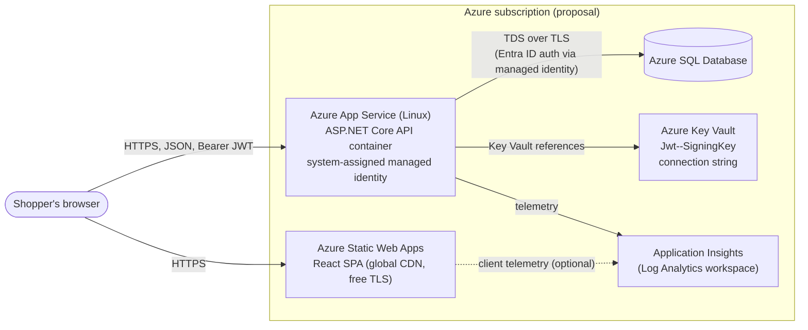

| Component | Role | Notes |
|---|---|---|
| Static Web Apps | Hosts the SPA bundle | `VITE_API_BASE_URL` set at build time to the App Service URL; CORS on the API allows the SWA origin. |
| App Service (Linux, container) | Runs the existing API image | TLS terminates at App Service, consistent with no in-app HTTPS redirection. Health check probe on `/health`. |
| Azure SQL Database | Same schema via EF Core migrations | Migrations run from the pipeline (migration bundle or idempotent script), with `Database:ApplyMigrationsOnStartup` left `false`. |
| Key Vault | `Jwt:SigningKey` and the connection string | Read through App Service Key Vault references with the managed identity; nothing secret in app settings. |
| Application Insights | Requests, dependencies (SQL), exceptions, logs | Needs the OpenTelemetry / Application Insights package, not referenced yet (planned). |

Other planned work for this target: Bicep or Terraform templates, a GitHub Actions pipeline (build,
test, publish image, deploy, run migrations), and `OpenApi:Enabled=false` in production.
